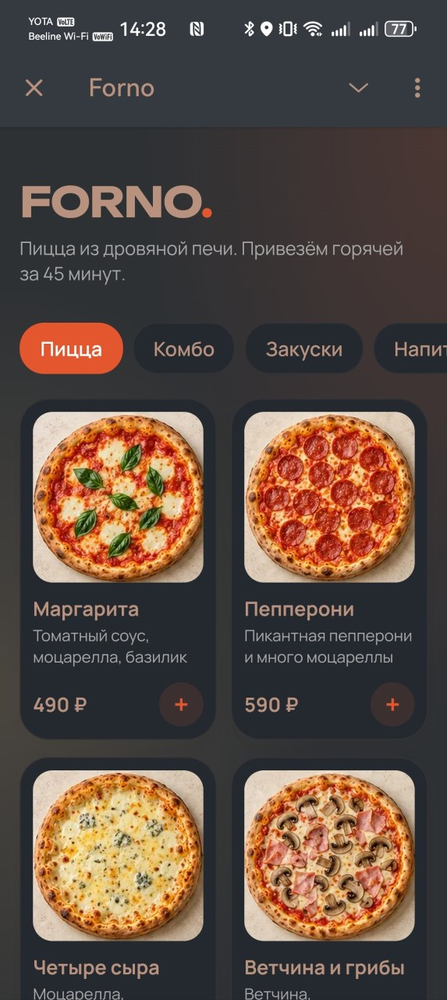
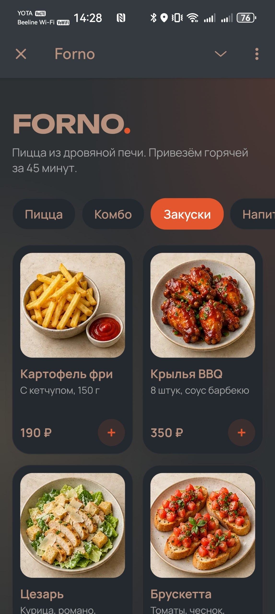

# Forno

### Магазин в Telegram с настраиваемым каталогом товаров

Учебный проект: Mini App для покупателей и два Telegram-бота для оформления и обработки заказов. Пиццерия Forno используется как пример наполнения магазина.

Покупатель открывает каталог прямо в Telegram, выбирает товары, указывает контакты и адрес. Администратор получает заказ в отдельном боте и управляет его статусом. Покупатель получает уведомления о принятии, выполнении или отмене заказа.

## Как выглядит магазин

<p>
  
  
</p>

## Что реализовано

* Каталог с фотографиями, описаниями, ценами и категориями.
* Корзина с изменением количества товаров и отображением суммы.
* Оформление заказа с проверкой формата телефона и обязательных полей адреса.
* Расчёт стоимости на сервере по ценам из каталога.
* Сохранение заказов в SQLite.
* Приём, отмена и завершение заказов в административном боте.
* Уведомления покупателю и ссылка на его профиль в сообщении администратору.

## Технологии

| Технология | Назначение |
| --- | --- |
| Python | Логика сервера и ботов |
| FastAPI и Uvicorn | Обработка HTTP-запросов и запуск веб-сервера |
| aiogram 3 | Работа двух Telegram-ботов |
| Pydantic | Проверка данных заказа |
| SQLite | Хранение заказов |
| HTML, CSS, JavaScript | Интерфейс Mini App |
| python-dotenv | Загрузка настроек из `.env` |

## Как устроен проект

```text
main.py           Сервер и оформление заказов
user_bot.py       Вход покупателя в магазин
admin_bot.py      Управление заказами и уведомления
db.py             Работа с базой данных
shop.json         Каталог и параметры магазина
static/           Страница, стили, JavaScript и изображения
requirements.txt  Библиотеки проекта
.env.example      Образец настроек без секретов
```

## Статус и развитие

Проект представляет собой учебную MVP-версию. Онлайн-оплата и проверка адресов по карте пока не подключены. Перед коммерческим использованием необходимы дополнительные доработки, включая проверку подписи Telegram initData на сервере.

Товары, цены, описания и изображения можно заменить под другую тематику. Для полного переоформления магазина сейчас также потребуется изменить отдельные тексты ботов и элементы оформления.

В дальнейшем планируется создать интерфейс управления контентом, в котором владелец сможет добавлять товары, загружать фотографии и менять тексты без редактирования кода.

## Настройки

Для запуска нужны Python 3.11+, зависимости из `requirements.txt`, два бота и личный `.env` с токенами, ID администратора и HTTPS-адресом Mini App. Секреты и база с данными покупателей не публикуются в репозитории. Новая база создаётся автоматически.

[Репозиторий проекта](https://github.com/NDV-dez/Forno)
